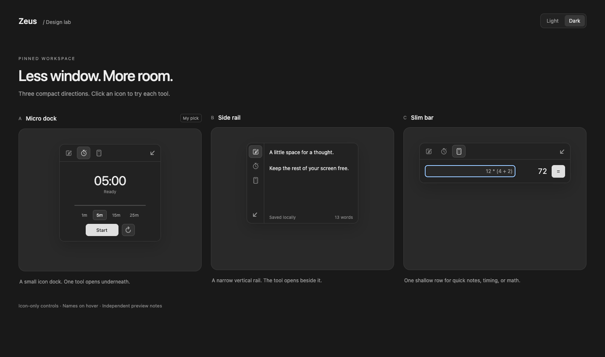

# Compact pinned directions

Open `/previews/pinned/` in the browser preview to try the actual tool views in
three layouts. These are experiments; the active native layout has not been selected.

| Direction      | Presentation                                               |
| -------------- | ---------------------------------------------------------- |
| A · Micro dock | A 176 × 40 px collapsed icon dock, with one tool below it. |
| B · Side rail  | A narrow vertical icon rail, with one tool beside it.      |
| C · Slim bar   | A horizontal icon bar with a shallow inline tool area.     |

Tool names remain in accessible labels and hover tooltips. The compact calculator
uses keyboard input and an equals button. Preview notes use their own storage keys;
preview interactions do not replace existing notes or saved native preferences.



## Tool organization

```text
src/renderer/
  tools/
    registry.ts        # Metadata and availability flags for every tool
    embedded.ts        # Typed embedded view registrations
    ToolIcon.tsx
    notes/
    timer/
    calculator/
    resize-image/
  pinned/
    PinnedWorkspace.tsx # Generic container, no tool-specific state
    pinned.css
    variants.css
```

A tool stays in its own folder when its presentation changes. Marking it `pinned: true`
adds it to the pinned catalog and requires an embedded view registration. Marking it
`launcher: true` requires its standalone page and explicit native registration. Future
user preferences can choose among eligible tools without moving source files.
